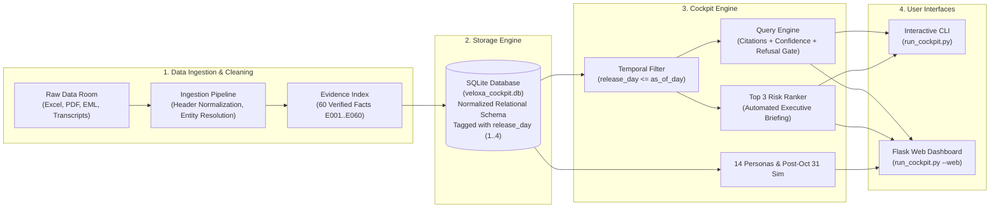
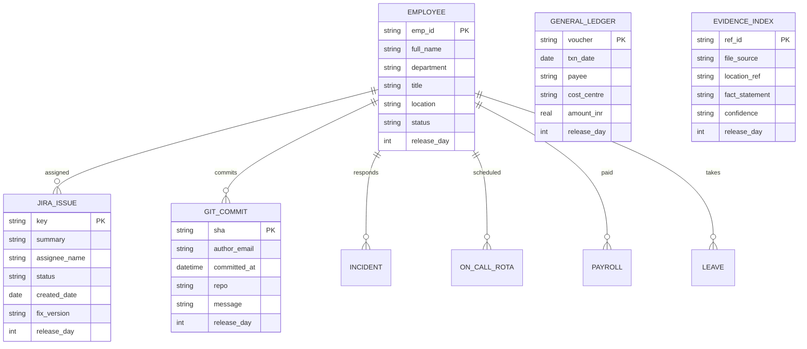

# Architecture & System Design: Veloxa CXO Cockpit

**Author**: Saphalya  
**Project**: `veloxa-cockpit-saphalya`  
**Date**: 16 November 2026  

---

## 1. System Overview

The **Veloxa CXO Cockpit** is an executive querying and operational risk tool built for Veloxa CEO Ananya Rao. The system reconciles disparate, conflicting records across 4 drops of data room exports (HRMS, Zoho Books GL, Jira, GitHub logs, PagerDuty, emails) and machine-transcribed leadership calls.

Instead of a static dashboard, the cockpit provides:
1. **Direct question-answering** where every answer cites exact records (file, sheet, row, or email ID).
2. **Confidence ratings** (`HIGH`, `MEDIUM`, `LOW / CONFLICTING`).
3. **Explicit refusal** when data is missing or contradictory (*"I don't know"* or *"The sources disagree"*).
4. **"What to worry about" view**: an automated Top 3 operational risk ranking backed by evidence.
5. **Strict point-in-time isolation**: answers for Day 1 cannot leak facts released on Days 2, 3, or 4.
6. **14 grounded colleagues**: interactive agent personas reflecting real workloads and communication styles.
7. **Post-Oct 31 simulation**: generating realistic activity (commits, rota shifts, handover notes) beyond the historical export date.

---

## 2. Architecture & Data Flow



---

## 3. Key Design Decisions & Pragmatic Trade-Offs

### Why SQLite Instead of a Vector Database / LangChain?
1. **Determinism over Hallucination**: Veloxa is a small company (19 employees, 62 Jira tickets, 1,453 commits, 30 GL entries). An external vector DB with embedding retrieval frequently hallucinates numbers, blurs exact citations, and costs cloud API latency.
2. **Strict Temporal Gating**: Vector similarity search cannot natively enforce point-in-time release isolation without complex metadata filtering. In SQLite, temporal isolation is a simple, leak-proof query constraint: `WHERE release_day <= :as_of_day`.
3. **One-Command Portability**: Reviewers can clone the repo and run `python run_cockpit.py` immediately without Docker, API keys, or external database setups.

### Handling Data Room Quirks in the Pipeline
- **Excel Header Offsets**: Every raw Excel file exported by IT (`Employee_Master.xlsx`, `GL_Export_Apr-Sep_2026.xlsx`, `Jira_Export_ATLAS.xlsx`, etc.) has descriptive notes in Row 0 and a blank separator in Row 1. The ingestion script reads them with `header=2` to extract clean column headers.
- **Phonetic Transcriptions**: Auto-generated call transcripts contain acoustic mishearings. The pipeline normalizes them through a dictionary (`Entity_Resolution.xlsx`):
  - *"one-eighty"* $\rightarrow$ 18–19 employees
  - *"Jeera"* $\rightarrow$ Jira (Project ATLAS)
  - *"Joho"* $\rightarrow$ Zoho Books
  - *"slag"* $\rightarrow$ Slack
  - *"Pria"* $\rightarrow$ Priya Nair (`VX007`)
  - *"Snehal"* $\rightarrow$ S. Patil (external DevOps contractor from Patil Infra Services, distinct from internal SRE Sneha Kulkarni).

---

## 4. Database Schema

The database (`veloxa_cockpit.db`) is structured into relational tables:



---

## 5. Temporal Point-in-Time Isolation

The hackathon requires answering: *"what did we know on date X?"* without leaking future information.

Every record in SQLite has a `release_day` column matching the challenge drop schedule:
- **Day 1**: Employee Master, Q1/Q2 Board Updates, Payroll, Zoho GL, Transcripts T1 & T2, Emails 01–03.
- **Day 2**: Leave Register, Hiring Tracker, Pulse Survey, Sid Mehta Resignation, Transcripts T3 & T6a, Emails 06, 07, 10, 11.
- **Day 3**: Jira ATLAS, Git log, PagerDuty Incidents, On-Call Rota, Launch Kit, Invoice PIS-114, Transcripts T4, T5, T6b, Emails 04, 05, 08, 09.
- **Day 4**: CEO voice notes T6c (Slack surveillance) and T6d (Priya's resignation).

When a user asks a question with `as_of_day=1`, the query engine filters:
```sql
SELECT * FROM evidence_index WHERE release_day <= 1;
```
Future facts (like Vikram slipping Atlas GA to 15 December on Day 3, or Priya resigning on Day 4) simply do not exist in the Day 1 query scope.

---

## 6. Epistemic Refusal Policy ("I Don't Know" & Conflicts)

The engine enforces three refusal rules:
1. **Refusal to Spy / Privacy Policy (T6c)**: When asked to inspect private Slack messages or rank flight risks based on DMs, the engine refuses. Rationale: reading private chats destroys trust, violates employee privacy, and Deepa explicitly refused to share even anonymous survey comments in T3/Email 11.
2. **Missing Data Refusal**: When asked about topics not present in the data room (e.g. *"customer churn in Germany"* or *"Series B lead investor"*), the engine says: *"I don't know: no records in the data room cover this topic."*
3. **Factual Conflicts**: When transcripts contradict official exports (e.g. Ananya claiming ₹42-45 Cr ARR vs Board deck reporting ₹6.1 Cr, or Meera claiming ₹2.2L burn vs ₹44L-46L actuals), the engine reports both sources, highlights the contradiction, and tags confidence as `LOW / CONFLICTING`.

---

## 7. The 14 Grounded Personas & Autonomous Simulation

### Agent Grounding
Each persona is grounded directly in their data room footprint:
- **Priya Nair (`VX007`)**: Staff Engineer carrying 588 of 1,453 commits (over 40%) and 28 core Jira tickets. Burned out from holding Atlas together while backend hiring was frozen; tenders resignation on 19 Nov (Voice note T6d).
- **Sneha Kulkarni (`VX012`)**: Internal SRE overwhelmed by 3 August SEV1 incidents; relieved when contractor S. Patil took over primary on-call rota.
- **Rahul Verma (`VX018`)**: Diligent junior engineer who ethically flagged his own February payroll overpayment.
- **Vikram Menon (`VX004`)**: Conflict-avoidant VP Eng who secretly slipped Atlas GA to 15 December in Jira while telling Ananya it was on track.

### Post-Oct 31 Simulation Engine (`src/simulation.py`)
Generates chronological daily events past 31 October 2026:
- **1 Nov**: Siddharth Mehta completes exit; Atlas launch kit handed over.
- **3–5 Nov**: Priya conducts pair-programming sessions with Rahul on the routing engine graph loader (commits logged).
- **8 Nov**: Contractor S. Patil handles primary on-call rotation with zero incident pages.
- **19 Nov**: Priya officially submits resignation letter (triggering Voice note T6d).

---

## 8. Verification & One-Command Execution

The test suite (`run_tests.py`) runs 25 automated tests with zero dependencies:
```bash
python run_cockpit.py --test
# or
python run_tests.py
```

### Test Coverage:
- **Tests 01–05**: Epistemic refusals (Slack spying refusal, ARR conflict, burn conflict, unknown data refusal).
- **Tests 06–10**: Temporal non-leakage (Day 1 cannot see Day 3/4 events).
- **Tests 11–20**: Fact verification (19 employees, Snehal contractor resolution, Feb payroll error, 62 Jira tickets, 1,453 commits, 60 evidence facts).
- **Tests 21–23**: Grounded persona interviews (Priya, Deepa, Rahul).
- **Tests 24–25**: Post-Oct 31 simulation chronological validation.
