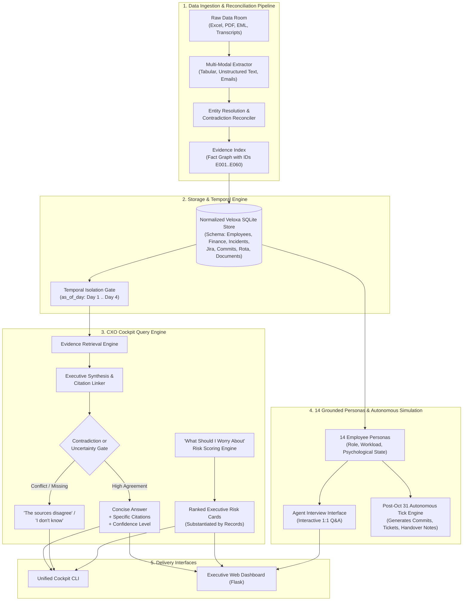
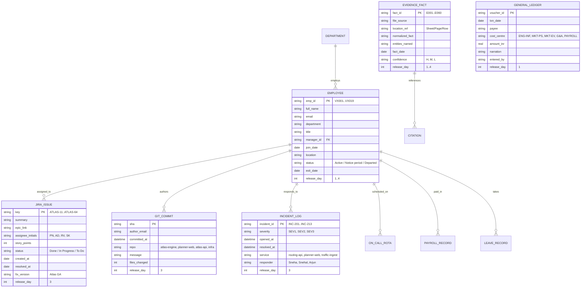
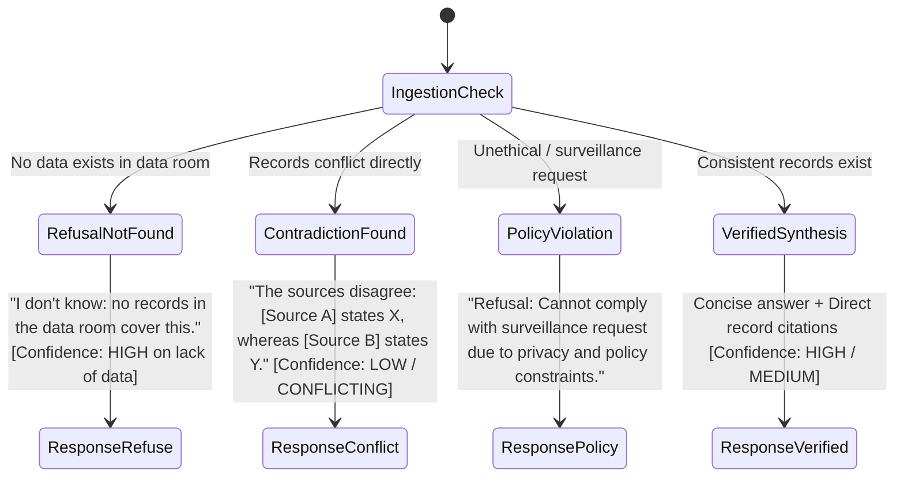

# Veloxa CXO Cockpit: Architecture & System Design

**Document Version**: 1.0.0  
**Date Committed**: Monday, 16 November 2026 (Due: 11:59 PM IST)  
**Author**: Saphalya (veloxa-cockpit-saphalya)  

---

## 1. Executive Summary & Purpose

The **Veloxa CXO Cockpit** is an executive intelligence system built for Veloxa Technologies CEO Ananya Rao. Rather than another static dashboard, the cockpit serves as an interactive, verifiable oracle that:
1. Answers executive queries concisely while citing exact underlying data room records.
2. Reports an explicit confidence score (**HIGH**, **MEDIUM**, **LOW / CONFLICTING**).
3. Adheres to an epistemic refusal standard—saying *"I don't know"* or *"The sources disagree"* when data is missing or contradictory.
4. Provides an automated **"What should I worry about"** executive view ranking top operational vulnerabilities backed by evidence.
5. Implements strict **Point-in-Time Isolation** preventing data leaks from later releases into earlier queries.
6. Simulates **14 real team members as grounded AI agents** who reflect authentic workloads, emotional contexts, and can autonomously generate plausible daily activity beyond 31 October 2026.

---

## 2. High-Level System Architecture



---

## 3. Data Model & Schema Design

The storage layer is built on a relational SQLite schema designed for temporal querying, cross-entity reconciliation, and exact evidence citation.

### Core Tables



---

## 4. Temporal Point-in-Time Isolation Engine

To fulfill the non-leakage requirement (*"what did we know on date X?"*), every entity, fact, and document is stamped with:
1. `record_date`: The real-world date the event happened (e.g. `2026-09-02` for Jira slip).
2. `release_day`: The hackathon release pack day on which this information became available to leadership:
   - **Day 1 (Mon 16 Nov 2026)**: T1, T2, Employee Master, GL Export, Payroll Register, Q1 & Q2 Board Updates, Templates, Emails 01–03.
   - **Day 2 (Tue 17 Nov 2026)**: T3, T6a, Hiring Tracker, Leave Register, Pulse Survey, Resignation Letter SM, Emails 06, 07, 10, 11.
   - **Day 3 (Wed 18 Nov 2026)**: T4, T5, T6b, Jira ATLAS, Git log, Incident log, On-Call Rota, Launch Kit, Invoice PIS-114, Emails 04, 05, 08, 09.
   - **Day 4 (Thu 19 Nov 2026)**: T6c, T6d (CEO voice notes on Slack surveillance and Priya's resignation).

### Temporal Query Filter Rule:
$$\text{Eligible Records} = \{ r \in \text{Database} \mid r.\text{release\_day} \le \text{Query}.\text{as\_of\_day} \land r.\text{record\_date} \le \text{Query}.\text{as\_of\_date} \}$$

Any record with $\text{release\_day} > \text{Query}.\text{as\_of\_day}$ is strictly filtered out prior to synthesis.

---

## 5. Epistemic Refusal & Uncertainty Engine

The engine answers with one of four calibrated modes:



---

## 6. The 14 Grounded AI Personas & Autonomous Simulation

### Persona Grounding Model
Each of the 14 team members is instantiated with a complete operational profile:
- **Hard Grounding**: Exact join date, salary tier, reporting manager, git commit volume, Jira backlog, incident response history, and leave records.
- **Narrative Grounding**: Grounded psychological reality synthesized from emails, pulse survey sentiment, and transcripts (e.g. Priya's architecture load and burnout; Sneha's on-call exhaustion; Arjun's preference for remote work in Pune; Rahul's ethical diligence).

### Post-October 31 Simulation Engine (Stretch Goal)
A discrete-event simulation engine steps forward day-by-day past 31 October 2026:
- **November 1**: Siddharth Mehta's resignation takes effect; marketing launch ownership freezes.
- **November 2-15**: Priya conducts daily pair-programming and technical handover sessions with Rahul Verma; commits are logged to `atlas-engine` with commit messages focusing on capacity rule documentation.
- **November 16-20**: On-call primary shifts handled by S. Patil (contractor), reducing internal engineer pages to zero; Vikram prepares board deck revisions.

---

## 7. Verification & Automated Testing Plan

The system includes an automated test runner (`run_tests.py`) testing at least 25 structured test cases:
1. **Fact Retrieval Accuracy (10 tests)**: Verified against Employee Master, GL, Board reports, Git commits.
2. **Point-in-Time Non-Leakage (5 tests)**: Verifies that Day 1 queries cannot see Day 2-4 events.
3. **Epistemic Refusal & Conflict Detection (5 tests)**: Verifies that the engine admits "the sources disagree" or "I don't know".
4. **Policy & Ethics Refusal (2 tests)**: Verifies refusal to spy on private Slack communications.
5. **Agent Simulation Consistency (3 tests)**: Verifies post-Oct 31 activity generated matches persona constraints.

---

## 8. Summary of One-Command Setup

The entire cockpit, database build, test execution, and user interface are executed using standard Python 3.10+ without complex external daemon dependencies:
```bash
python run_cockpit.py          # Builds DB, runs verification, launches interactive cockpit
python run_tests.py            # Executes the 25+ automated tests with report output
```

